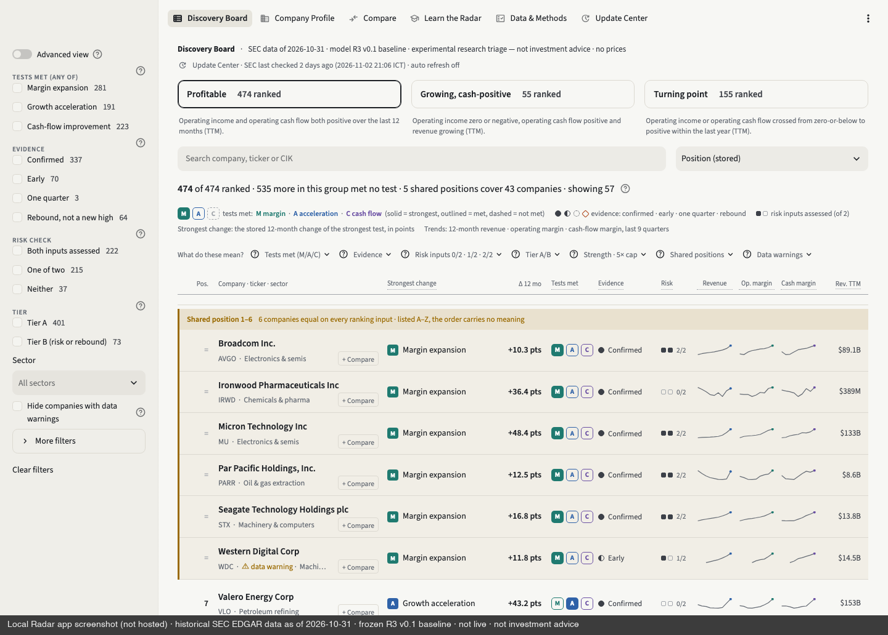

# US Fundamental Inflection Radar

> การบ้าน AI Investor Alpha · Day 1 → Day 2

| | |
|---|---|
| **ชื่อเล่น** | Tawan |
| **กลุ่ม** | Group 2 (g02) · หุ้นสหรัฐ / fundamental screening |
| **โจทย์ 1 บรรทัด** | ใช้ AI ช่วยสร้างเครื่องมือคัดกรองหุ้นสหรัฐจาก SEC EDGAR เพื่อหาบริษัทที่งบการเงิน "เพิ่งเริ่มดีขึ้น" แล้วส่งต่อไปศึกษาเชิงลึก (ไม่ใช้ราคา ไม่แนะนำซื้อขาย) |
| **ลิงก์ผลงาน** | ดูใน `output/` — เริ่มที่ [`output/submission/`](output/submission/) |
| **สถานะ** | พร้อมตรวจ · Phase 0 (technical validation) เสร็จ · Phase 1 ทำงานได้ใน repo local (รันทั้ง U3 + dashboard) · ยังไม่ได้ validate คุณภาพโมเดล |

---

## อ่าน 30 วินาที

- **ทำอะไร:** อ่านงบจาก SEC EDGAR (companyfacts XBRL) → สร้างตัวเลขรายไตรมาสพร้อม provenance ถึง filing → จัดคลาส **P** (กำไรและเงินสดบวก) / **G** (ยังขาดทุนแต่เงินสดบวกและรายได้โต) / **T** (เพิ่งพลิกเป็นบวก) / **W** (เฝ้าดู ไม่จัดอันดับ) → ทดสอบ 3 เส้นทางการดีขึ้น (operating margin, การเร่งของรายได้, cash-flow margin) → จัดอันดับในคลาสด้วย threshold multiple → shortlist สำหรับศึกษาต่อ
- **ทำงานได้จริงแล้ว:** pipeline บนข้อมูล SEC จริง snapshot **2026-10-31** ครอบคลุม U3 2,964 บริษัท (core 1,571 · ได้อันดับ 705) · dashboard Streamlit แบบ read-only ในเครื่อง · automated tests 583 ตัวผ่าน · manual reconciliation 240 ค่าจาก 10 บริษัท
- **ส่งอะไร:** ตัวอย่าง 30 บริษัทที่เลือกไว้ล่วงหน้าแบบ deterministic พร้อมหลักฐาน ([CSV](output/submission/sample30_evidence.csv)), ภาพหน้าจอจริง 3 ภาพ, coverage summary และคำอธิบายวิธีการ
- **ไม่ใช่:** ไม่ใช่ข้อมูล live, ไม่ใช้ราคาหุ้น, ไม่มี valuation, ไม่มี backtest, ไม่ใช่คำแนะนำลงทุน



## ลำดับการทำงาน

```text
SEC filings (companyfacts · submissions · tickers)
  → Financial reconstruction (fact → ไตรมาส, provenance, reconciliation)
  → P / G / T / W classification (truth table 16 แถว)
  → Ranking ในคลาส (Tier, threshold multiple ≤ 5×, จำนวนเส้นทาง)
  → Research shortlist (ผู้ใช้ไปอ่าน 10-Q / 10-K ต่อเอง)
```

## วิธีอ่านผลลัพธ์

1. [`output/submission/sample30_evidence.csv`](output/submission/sample30_evidence.csv): 30 แถว มี CIK, ticker, คลาส, เส้นทาง, สัญญาณ, ตัวเลข TTM, หนี้/risk, วันสิ้นไตรมาส/วันยื่น, accession + URL บน sec.gov และบอกว่าเคย reconcile ด้วยมือหรือไม่
2. [`output/submission/METHODOLOGY.md`](output/submission/METHODOLOGY.md): แหล่งข้อมูล, วิธีเลือก 30 บริษัท, ผลแยกตามคลาส, อะไรตรวจแล้ว/ยังไม่ตรวจ, คำอธิบายคอลัมน์
3. [`output/submission/COVERAGE_SUMMARY.md`](output/submission/COVERAGE_SUMMARY.md): funnel, class × eligibility, ความครบของข้อมูล risk, freshness
4. [`output/submission/screenshots/`](output/submission/screenshots/): Discovery Board · Company Profile ของ Federal Signal พร้อม reconciliation และรายการ filing · Coverage & freshness
5. [`output/phase0/PHASE0_REPORT.md`](output/phase0/PHASE0_REPORT.md): รายงาน Phase 0 ฉบับเต็ม (gates G0.1–G0.14) · [`output/design/`](output/design/): เอกสารออกแบบ R3

ผลของ 30 บริษัท: P 13 (ได้อันดับ 7) · G 2 · T 2 · W 4 · ประวัติสั้น 3 · excluded 6 (รวม negative controls 3) เป็นผลจริงของ engine ไม่ได้กำหนดคลาสให้

## ข้อจำกัด (อ่านก่อนใช้ตัวเลข)

- **วันที่ข้อมูล:** SEC snapshot 2026-10-31 (ไตรมาสล่าสุดใน run จบ 2026-10-04) ไม่ได้อัปเดตอัตโนมัติ
- ตัวอย่าง 30 บริษัทเป็น **purposive sample** สำหรับทดสอบกรณียาก ใช้อ้างถึงทั้งตลาดไม่ได้
- **reconcile ด้วยมือแค่ 10 จาก 30 บริษัท** อีก 20 ตรวจด้วย automated reconciliation ของ pipeline เท่านั้น
- threshold ทุกตัวเป็นค่าชั่วคราวที่ freeze ก่อน run และไม่ได้ปรับตามผล · ยังไม่ได้พิสูจน์ว่าโมเดลคัดหุ้นได้ดี (blind review ทางการกำหนดไว้บนข้อมูลตั้งแต่ 2027-02-01)
- หนี้ที่รายงานแบบ XBRL dimension มองไม่เห็น จึงแสดงเป็น "ไม่ทราบ" (core 384 จาก 1,571) · "ไม่มี risk flag" ไม่ได้แปลว่า "ปลอดภัย"
- แยก NYSE American จาก NYSE ไม่ได้ · ไม่มีข้อมูล point-in-time

## ชุดส่งตรวจกับระบบจริงในเครื่อง

| | อยู่ใน repo นี้ (Public) | อยู่ใน repo local (ไม่เผยแพร่) |
|---|---|---|
| เอกสาร | spec, prompts, memory, help, รายงาน Phase 0, เอกสารออกแบบ | checkpoint ทุก phase, decision log |
| ข้อมูล | CSV 30 บริษัท, coverage summary, ภาพหน้าจอ 3 ภาพ | SEC bulk (~3 GB), warehouse parquet, ผลทั้ง U3 |
| โค้ด | ไม่มี | pipeline Python, dashboard Streamlit, tests 583 ตัว |

ผู้สอนตรวจตัวเลขเทียบ sec.gov ได้ (ทุกแถวใน CSV มี accession + URL) แต่รันโค้ดซ้ำจาก repo นี้ไม่ได้

## ไฟล์ใน repo นี้

| ไฟล์ | ใส่อะไร |
|---|---|
| `spec.md` | โจทย์ 5 หัวข้อ พร้อมสถานะที่ทำได้จริง |
| `prompts.md` | บันทึกขั้นตอนทุกรอบ: ทำอะไร, prompt, ผลที่ได้, ตัดสินใจเพราะอะไร |
| `PROJECT_MEMORY.md` | ปัญหาที่เจอ, วิธีแก้, และกฎที่ได้จากบทเรียน |
| `output/` | ผลงาน: `submission/` (ชุดส่งตรวจ), `phase0/`, `design/` |
| `help.md` | ติดตรงไหน 3 ข้อ ให้ผู้สอนเตรียมคำตอบ |
| `AGENTS.md` | คำสั่งให้ AI ทุกค่ายทำงานใน repo นี้ (`CLAUDE.md` และ `GEMINI.md` ชี้มาที่ไฟล์นี้) |
| `.claude/commands/save.md` | ขั้นตอนของคำสั่ง `/save` |

## ห้ามขึ้น Public

repo นี้ใครก็เปิดดูได้: ไม่มี API key, password, token, `.env`, พอร์ตจริง, ข้อมูลที่ซื้อมา หรือบทวิเคราะห์โบรกเกอร์ · ข้อมูลทั้งหมดมาจาก SEC EDGAR ซึ่งเป็นข้อมูลสาธารณะ

## เช็กก่อนส่ง

- [x] repo เป็น Public
- [x] `spec.md` ครบ 5 หัวข้อ
- [x] `prompts.md` มีบันทึก 3 รอบ และทุก commit มี entry คู่กัน
- [x] `PROJECT_MEMORY.md` มีปัญหาและบทเรียน
- [x] `output/` มีภาพหน้าจอ 3 ภาพ + CSV + สรุป
- [x] `help.md` เขียนครบ 3 ข้อ
- [x] ไม่มี key, password หรือข้อมูลพอร์ตจริงในทุกไฟล์
- [ ] ส่งลิงก์แล้ว (ผ่าน Google Form ของผู้สอน)
